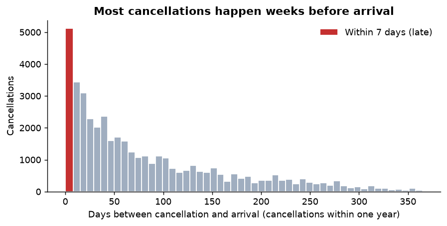
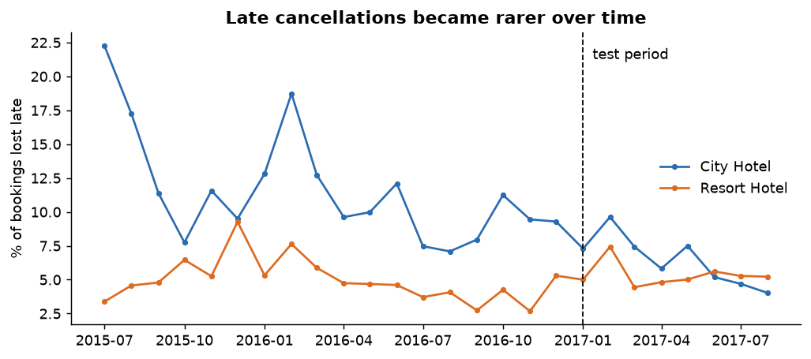
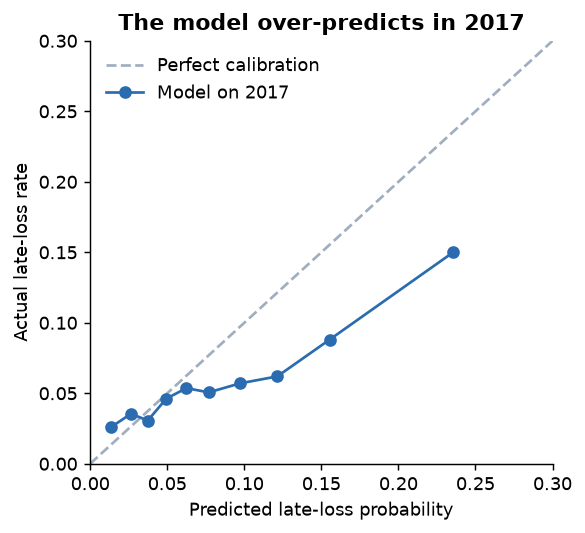
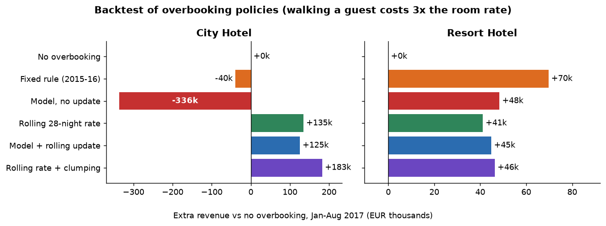
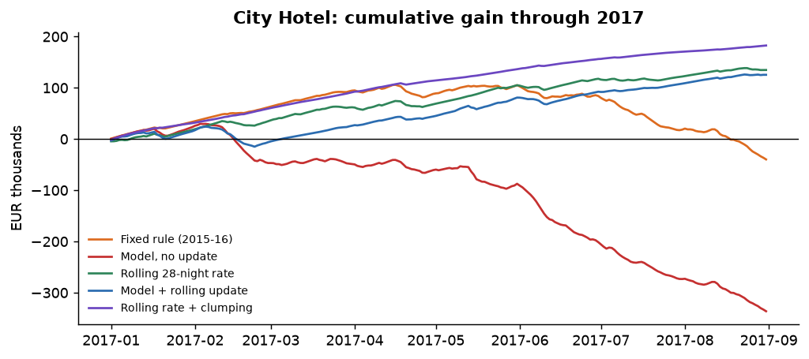
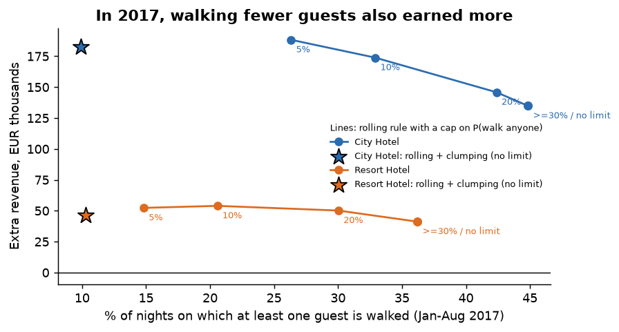
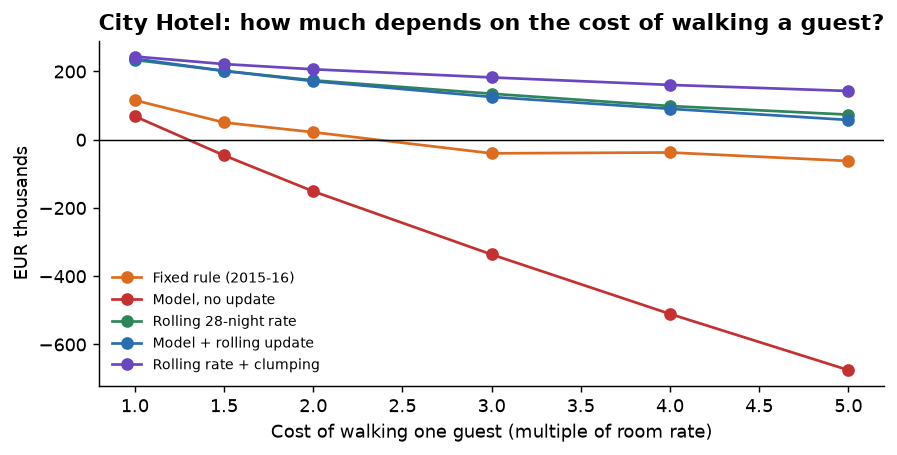

# How Many Rooms Should a Hotel Overbook?
### Predicting late cancellations and testing overbooking rules on 119,000 real bookings

*Reference report (model answer) for the 14-week project in [`docs/project_brief_vi.md`](../docs/project_brief_vi.md). Every number comes from `results/` and can be regenerated with `bash scripts/run_all.sh`. Student details: [Student name] · [School] · [Month Year].*

---

## 1. Summary

Hotels lose money when guests cancel at the last minute or do not show up, because the room stays empty. Overbooking – selling more rooms than the hotel has – fills those rooms, but if too many guests arrive, the hotel has to send someone to another hotel ("walking" a guest), which is expensive.

Using 119,390 bookings from two hotels in Portugal (2015–2017), I predicted which bookings would be lost late, decided how many rooms to overbook each night, and tested six overbooking rules on January–August 2017.

**Main results** (City Hotel, walking a guest costs 3× the room rate):

| Rule | Extra revenue vs no overbooking | Nights with a walked guest |
| --- | --- | --- |
| Cancellation model trained on 2015–16, never updated | **−€336,000** | 207 of 243 |
| Simple rule: late-loss rate of the last four weeks | +€135,000 (+2.3%) | 109 |
| Same rule, allowing for cancellations that come in clumps | **+€183,000** (+3.1%) | **24** |

**What I learned.** (1) A more accurate-looking model is not the same as a better decision: it has to be judged in euros, and it has to keep learning, because guests in 2017 cancelled half as often as in 2015. (2) Cancellations do not behave like independent coin flips. Allowing for that made the rule far more careful: it walked guests on 24 nights instead of 109. In a second test period it earned about 10% less than the simple rule, so it is the *safer* rule, not a free lunch.

---

## 2. The business problem

A hotel with 226 rooms that sells exactly 226 rooms will usually have empty rooms, because some guests cancel too late to resell the room and some never show up. Each empty room costs about one night's room rate (r).

If the hotel sells 226 + x rooms, it fills more of those empty rooms, but on some nights more guests arrive than there are rooms. Each guest who has to be walked costs w: a room at another hotel, transport, an apology, and a guest who may not come back.

So the question is: **for each night, what x balances empty rooms against walked guests?**

This is a version of the *newsvendor problem*. If L is the number of rooms lost late, the best x satisfies

> P(L ≤ x) ≈ r / (r + w)

If walking a guest costs 3× the room rate, r / (r + w) = 1/4. The hotel should overbook only up to the 25th percentile of late losses – it should be careful, because a mistake in one direction costs three times more than in the other.

The rule needs a *distribution* for L, not just its average. The textbook choice is the binomial: every booking is lost with the same probability p, independently of the others. Section 5 (Finding 5) tests that assumption.

---

## 3. Data

The data comes from the property management systems of two hotels in Portugal: a city hotel in Lisbon and a resort in the Algarve (Antonio, de Almeida & Nunes, 2019). It contains every booking due to arrive between 1 July 2015 and 31 August 2017, including bookings that were cancelled.

| | City Hotel | Resort Hotel |
| --- | --- | --- |
| Bookings (after cleaning) | 79,162 | 40,046 |
| Cancelled (any time) | 41.8% | 27.8% |
| Lost late (cancelled ≤ 7 days before arrival, or no-show)* | 9.4% | 5.1% |
| Estimated number of rooms | 226 | 187 |

\* Among bookings still active 7 days before arrival.

**Cleaning.** I removed 180 bookings with no guests, one booking with a negative room rate and one with a rate of €5,400 per night (182 rows in total, 0.15%).

**What the data does not have.** It does not say how many rooms each hotel has. I estimated capacity as the largest number of rooms ever occupied on one night. If the true number is higher, my results understate the value of overbooking.

---

## 4. Method

**Step 1 – Define the label that matters.** A cancellation two months before arrival costs the hotel almost nothing, because the room can be sold again. I defined a booking as **lost late** if it was cancelled within 7 days of arrival or the guest did not show up. I only looked at bookings still active 7 days before arrival, which is when the overbooking decision is made.

**Step 2 – Only use information available at booking time.** Inputs: hotel, lead time, number of nights and adults, room rate, deposit type, market segment, distribution channel, customer type, meal plan, room type, arrival month, waiting-list days, special requests and the guest's history. I excluded columns that are updated after the booking (Section 6).

**Step 3 – Predict late losses.** I trained a logistic regression and a gradient-boosting model on arrivals in 2015–2016 and tested on arrivals in 2017. I measured AUC (how well the model ranks risky bookings) and calibration (whether a predicted 10% really means 10%).

**Step 4 – From bookings to room-nights.** A three-night booking occupies a room on three nights. For each hotel and night, I counted rooms on the books, rooms lost late, and the average predicted late-loss probability.

**Step 5 – Decide x and backtest.** For each night in 2017, each rule chose x with the newsvendor rule above. I then used what really happened that night (the share of bookings actually lost late) to calculate the extra revenue and the number of guests walked. The rules differ in how they estimate the late-loss rate p and its spread:

| Rule | How p is estimated | Distribution of L |
| --- | --- | --- |
| No overbooking | x = 0 | – |
| Fixed rule | One x for every night: the one that earned most in 2015–2016 | – |
| Model, no update | Average predicted probability of the bookings on that night | binomial |
| Rolling 28-night rate | Actual late-loss rate over the previous 28 nights that had already finished 8 days earlier | binomial |
| Model + rolling update | Model prediction × (recent actual rate ÷ recent predicted rate) | binomial |
| Rolling rate + clumping | Same p as the rolling rule | beta-binomial, extra spread learned from 2015–16 |

**Step 6 – Check the result on a second period.** The clumping rule was added after I had seen the 2017 results (Section 6). To avoid fooling myself, I re-ran the rate-based rules on July–December 2016, learning only from July 2015–June 2016.

---

## 5. Findings

### Finding 1: Most cancellations do not cost the hotel money

37% of bookings were cancelled, which sounds alarming. But the median cancellation happened **56 days** before arrival, and only **11.9%** of cancellations came in the last 7 days. The share of active bookings actually lost late was 9.4% at the city hotel and 5.1% at the resort. Overbooking should be based on these numbers, not on 37%.

### Finding 2: Late cancellations became much rarer over time

At the city hotel, the late-loss rate fell from **12.0%** of active bookings in 2015 (July–December) to **10.5%** in 2016 and **6.4%** in January–August 2017. The resort stayed around 5%. I do not know why – possible reasons include stricter cancellation policies, a different mix of travel agents, or changes in how the hotel recorded no-shows – but any model trained on the past would expect too many late losses in 2017.

### Finding 3: The model ranks risk reasonably well but over-predicts

| Model (predicting late loss, tested on 2017) | AUC |
| --- | --- |
| Logistic regression | 0.652 |
| Gradient boosting | 0.690 |

Predicting *late* losses is much harder than predicting any cancellation (AUC 0.805), because last-minute changes depend on things the hotel cannot see at booking time. The bigger problem is calibration: the model predicted an average of **8.8%** for 2017 bookings, while the real rate was **6.0%**. For the riskiest tenth of bookings it predicted 23.5%; the real rate was 15.0%.

The strongest signals were the deposit type (see Section 6 for a warning), full-board meal plans (higher risk) and corporate or group customers (lower risk).

### Finding 4: Updating beats a better model

| City Hotel, Jan–Aug 2017, w = 3× room rate | Avg rooms overbooked | Extra revenue | % of room revenue | Nights with a walk | Guests walked |
| --- | --- | --- | --- | --- | --- |
| No overbooking | 0 | €0 | 0% | 0 | 0 |
| Fixed rule (2015–16) | 17.0 | −€40k | −0.7% | 155 | 973 |
| Model, no update | 23.9 | **−€336k** | −5.7% | 207 | 2,031 |
| Rolling 28-night rate | 14.5 | +€135k | +2.3% | 109 | 510 |
| Model + rolling update | 14.9 | +€125k | +2.1% | 99 | 577 |
| Rolling rate + clumping | 8.5 | **+€183k** | +3.1% | **24** | **53** |

At the city hotel, the model that was never updated overbooked by about 24 rooms a night, walked more than 2,000 guests and lost money. The simple rolling rule overbooked by about 15 rooms and made money. Adding the model to the rolling update did not help.

The cumulative chart shows *when* things went wrong: the fixed rule kept pace with the best rules until May, then late cancellations fell further and it gave back all its gains.

At the resort, where late cancellations did not drift, every rule made money (+€41k to +€70k), and the fixed rule did best. **The right rule depends on whether the world is changing.**

### Finding 5: Cancellations come in clumps, so the textbook rule is too bold

If every booking were lost independently with probability p, the number lost on a night would follow a binomial distribution. On 2015–16 nights, the real numbers varied **6.3 times** (city) and **4.7 times** (resort) more than the binomial allows, measured as the variance of the standardised error. Groups cancel together, and bad weeks come in runs.

A rule that ignores this under-estimates the chance of a very full night and overbooks too much. The *Rolling rate + clumping* rule keeps the same p as the rolling rule but uses a beta-binomial distribution, whose extra spread (ρ = 0.029 at the city hotel, 0.025 at the resort) is learned from 2015–16 only. It overbooked about 8 rooms a night instead of 15, earned **+€183k** at the city hotel, and walked guests on **24 nights instead of 109** (53 guests instead of 510). At the resort it earned +€46k (vs +€41k) and walked guests on 25 nights instead of 88.

The chart shows another way to be careful: keep the plain rolling rule but forbid any x with more than a 5%, 10% or 20% chance of walking someone. In 2017 every limit *raised* revenue at the city hotel, because the rolling rate lagged behind a falling late-loss rate. The clumping rule reaches a lower walking rate than any limit, at similar revenue.

**An honest check.** I thought of the clumping rule only after seeing the 2017 results, so a good 2017 result could be luck. On July–December 2016, a period it never saw:

| Jul–Dec 2016, w = 3× | City: extra revenue | City: nights with a walk | Resort: extra revenue | Resort: nights with a walk |
| --- | --- | --- | --- | --- |
| Rolling 28-night rate | +€180k | 60 | +€32k | 49 |
| Rolling rate + clumping | +€162k | **10** | +€18k | **1** |

Here the clumping rule earned **about 10% less** at the city hotel (and 45% less at the resort) but almost never walked anyone. So the fair conclusion is: allowing for clumping makes the rule much **safer**; whether it also earns more depends on the period. For a hotel that cares about its reputation, giving up 10% of the overbooking gain to walk guests on 10 nights instead of 60 looks like a good trade.

### Finding 6: The conclusions hold for any reasonable walking cost

I do not know exactly what it costs to walk a guest, so I tried values from 1× to 5× the room rate. At the city hotel the rolling rule earned between **+€234k** (1×) and **+€74k** (5×), and the clumping rule between **+€244k** and **+€143k**. The un-updated model only made money if walking a guest was almost free (1×); at 5× it lost €675k.

---

## 6. What went wrong and how I fixed it

**1. My first model looked much better than it really was.** My first model predicting cancellations had an AUC of 0.865. Then I asked, for each column, "does the hotel know this when the guest books?" Four columns fail that test: `booking_changes` (counted until check-in or cancellation), `assigned_room_type` (decided at check-in), `country`, and `required_car_parking_spaces`. The last one surprised me: **all 7,409 bookings with a parking request checked in – not a single cancellation or no-show.** That only makes sense if parking is recorded when the guest arrives. Without these columns the honest AUC is 0.805.

**2. A random train/test split also flattered the model.** Mixing 2015, 2016 and 2017 bookings in both training and test sets gave AUC 0.830, because the model could learn from the "future". A hotel never has that luxury, so I always trained on the past and tested on 2017.

**3. I was predicting the wrong thing at first.** I started by predicting any cancellation. Finding 1 showed that most cancellations are harmless, so I switched to late losses.

**4. A strange category: "non-refundable" bookings.** 14,586 bookings had a non-refundable deposit, and **99.4% were cancelled – only 93 guests actually stayed.** Logically, a non-refundable deposit should make people *less* likely to cancel. These bookings were mostly groups and travel agents booking about 6 months ahead (median 183 days vs 69 for all bookings), so they may be blocks of rooms held by agents and released later, or a coding issue in the hotel's system. I kept the column because it is known at booking time, but I treat its huge effect in the model with suspicion.

**5. Trusting a model that stopped matching reality.** When I first ran the backtest, I expected the model to win. It lost €336k at the city hotel. By comparing the average prediction (8.8%) with what actually happened (6.0%), and plotting late cancellations by month (Finding 2), I found the cause: the hotel's guests had changed. The fix was not a more complex model but a rule that keeps learning from recent nights.

**6. A robustness check that could never fail.** To answer "what if the hotel could not sell the extra rooms?", I first capped sales at the number of bookings each night really received. Every rule then walked **zero** guests – which looked great until I realised why: capacity was *estimated* as the busiest night in the data, so by construction no real night ever had more guests than rooms. The check was circular, and I removed it. Section 7 uses a different, honest approximation.

**7. Almost tuning on the test set.** The clumping rule came from looking at 2017 results (a 5% walking limit earned *more* than no limit, which made me ask why). Reporting only its 2017 result would have been tuning on the test set. Learning its one parameter from 2015–16 and re-testing on July–December 2016 (Finding 5) showed a more modest – and more believable – picture.

---

## 7. Limitations

- **Demand is assumed.** The backtest assumes the hotel could always sell the extra rooms. Only 49% of 2017 nights at the city hotel (23% at the resort) had at least as many bookings as rooms. If the hotel could not have sold a single extra room on the other nights, the city hotel's gain from the clumping rule would shrink from €183k to about **€86k**, and the rolling rule's from €135k to €86k.
- **Room counts are estimates** based on the busiest night in the data.
- **The outcome of each night is replayed, not simulated.** I apply the share of bookings really lost late that night to C + x bookings. The extra x bookings might behave differently from the real ones.
- **Two hotels, one country, 2015–2017.** Results may not apply to hotels in Vietnam today.
- **I cannot fully verify how some columns were recorded** (country, deposit type), so some conclusions are hypotheses.

---

## 8. Talking to a real hotel

*[To be completed by the student: short summary of the conversation with a hotel manager or front-desk staff in Hanoi – whether they overbook, how they decide, what it costs to walk a guest, whether they have a limit on how often they may walk guests, and how this compares with the assumptions above.]*

---

## 9. What I would do next

1. Use separate late-loss rates for weekdays, weekends and holidays.
2. Model *how many extra bookings* the hotel could actually sell on each night, instead of assuming unlimited demand.
3. Let the clumping parameter update over time, like the rolling rate does.
4. Test the rule on a newer dataset or with a Vietnamese hotel's (anonymised) data.

---

## References

- Antonio, N., de Almeida, A., & Nunes, L. (2019). Hotel booking demand datasets. *Data in Brief*, 22, 41–49.
- Data used: TidyTuesday 2020-02-11 copy of the dataset, https://github.com/rfordatascience/tidytuesday/tree/master/data/2020/2020-02-11
- Talluri, K. T., & van Ryzin, G. J. (2004). *The Theory and Practice of Revenue Management*. Springer. (Chapter 4: overbooking.)
- Code and full results: https://github.com/ducminhngo871/hotel-overbooking
- Interactive app: https://hotel-overbooking-ducngo.streamlit.app/
